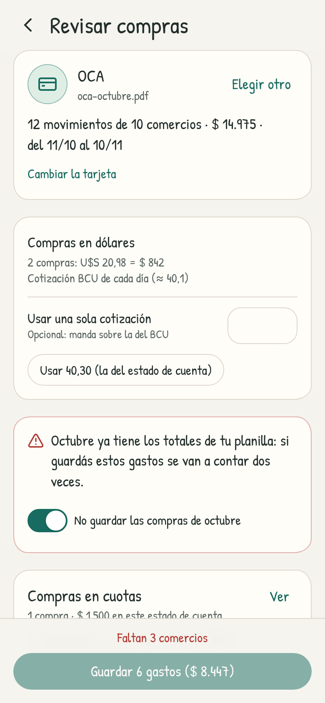

<p align="center"></p>

# Pengar

**Tu dinero, más simple.** Con un suricata que te acompaña. App de iPhone para anotar gastos en dos toques, escanear facturas y tickets (foto o PDF), subir el estado de
cuenta de la tarjeta (aprende el rubro de cada comercio) y ver cómo se mueve la plata en el tiempo. Todo queda en el teléfono
o, si querés, compartido con tu casa (cada uno anota en el suyo).

<p align="center">
  
  
  
  
</p>

## Qué hace

- **Anotar rápido**: monto → rubro → listo. Los rubros que más usás aparecen primero; fecha y nota son opcionales.
- **Facturas y tickets**: sacás una foto (o subís un PDF) y Pengar lee comercio, fecha, total y cada renglón, y le
  pone un rubro a cada uno. Podés separar la factura por rubro (comida y limpieza del súper, por ejemplo) o guardarla
  como un solo gasto. Lo que corregís lo aprende. El archivo queda guardado y se ve dentro de la app
  (desde el gasto o en Más → Facturas y estados de cuenta), con «Compartir o guardar» para mandarlo a Archivos o por mail.
  - En el iPhone se lee con Vision de Apple (en el teléfono, gratis, sin conexión). Los PDF con texto se leen
    directo; los escaneados se pasan por el lector de fotos.
  - Opcional: con una clave de la API de Claude (Ajustes) la lectura es mejor, sobre todo en tickets arrugados.
  - Los renglones que no reconoce por lo aprendido ni por las palabras clave se los pregunta a Apple Intelligence
    (iOS 26+, en el teléfono y sin costo) y, lo que siga sin rubro, a Claude si hay clave. Quedan marcados
    «sugerido por …» para revisarlos; al guardar, se aprenden. Ajustes muestra si el iPhone tiene Apple Intelligence.
  - **Ticket oficial de la DGI** (en el iPhone): Vision lee también el QR del e-Ticket en la misma pasada o, si no se
    ve, los códigos impresos (RUT, e-Ticket, serie y número, código de seguridad). El total y la fecha del QR son
    exactos y el RUT dice el comercio (Disco, Devoto, Géant, Macromercado, Tienda Inglesa). De esos súper se trae el
    ticket oficial (Rondanet; Tienda Inglesa, su propio portal) y se usan sus renglones en vez de los leídos (con
    clave de Claude, tampoco se le manda la foto); igual pasan por los rubros sugeridos. Lo pide el plugin nativo
    (los portales no tienen CORS), con una sesión efímera y hasta 25 s; solo se leen los renglones de la primera página hasta
    «TOTAL A PAGAR» (nunca la ADENDA, que trae los datos del cliente) y el PDF no se guarda. Si todavía no está
    publicado (hay hasta el día hábil siguiente), no hay conexión o no se entiende, queda lo leído de la foto con el
    total y la fecha del QR, y lo dice («mañana sacale la foto de nuevo»; sin QR, con los códigos leídos de lo
    impreso, también puede ser un código mal leído, y lo dice así). Lo leído de la foto de un ticket de Disco, Devoto o
    Géant no trae renglones de más: ni el año de la fecha, ni el renglón de la cantidad («1.324 KG x 319.00»), ni el
    código de seguridad. La revisión muestra «Ticket oficial de la DGI» o «Total y fecha del QR de la
    DGI», con «Ver en la DGI» (el link del QR). En la web no hay QR ni ticket oficial.
- **Estado de cuenta de la tarjeta** («Tarjeta» en Inicio): el PDF del banco (OCA, Visa/Master del BROU, Itaú,
  Santander, Scotiabank…), la planilla CSV o Excel que exporta o, en el iPhone, una foto. Las compras se juntan por
  comercio (sin sucursal, ciudad ni procesador de pago: «MERCADOPAGO*LA PASIVA SUC 3» es «La Pasiva»).
  - La primera vez se le dice el rubro de cada comercio («Nuevos») y lo aprende: el mes siguiente solo pregunta por
    los que no conoce; el resto queda en «Ya los conozco», plegado y editable. «No es un gasto» también se recuerda.
  - Los comercios nuevos se le preguntan a Apple Intelligence (o a Claude, si hay clave) y quedan «sugeridos».
  - Compras en U$S pasadas a pesos con la cotización del BCU del día de cada compra (o una sola, si se escribe en
    «Usar una sola cotización»; la del estado de cuenta se ofrece con un toque), cuotas en la nota,
    posibles repetidos con lo ya anotado (no se guardan salvo que se pida; lo anotado en dólares se compara en dólares,
    por la cuenta de la nota, sin depender de la cotización), pagos, saldos y créditos aparte (el reintegro de IVA se
    puede restar) y aviso si el mes ya tiene los totales de la planilla. Si el BCU no contesta, lo dice («No se pudo
    traer la cotización del BCU: escribila») con «Probar de nuevo».
  - Cada compra queda como un gasto con su fecha, la tarjeta en la nota y el estado de cuenta adjunto (Más →
    Facturas y estados de cuenta; las planillas se ven como tabla). Al guardar, «Deshacer» borra lo creado.
  - **Cuotas**: «CUOTA 02/06», «CTA 2 DE 6», «C.2/6», la de Scotiabank pegada al final del comercio («… C03/03» y
    hasta sin espacio, «HELADERIA LA NUBEC01/02»: el comercio queda sin ella) y la columna de Itaú («6/12», «3/ 3», en su
    propia celda). Un «MM/AA» suelto con el año del cierre (o el de antes o después) es una fecha, no una cuota
    («CUOTA SOCIAL 09/26», «UTE FACTURA 08/26»), salvo después de «cuota», «cta» o «C» o en su celda; «3/ 30», tampoco. Varios
    bancos repiten en cada cuota la fecha de la compra original (la 7/9 con fecha de marzo en el de setiembre): si
    es de antes del período, el gasto va con la fecha de cierre y la nota dice de cuándo es la compra («Itaú · cuota
    7/9 · compra del 3/3/2026 · U$S 25,00 × 40,50»: la cuenta en dólares sigue al final). Es en el borrador
    (`installmentsAtClosing`), así los repetidos usan esa fecha: subir el mismo estado de cuenta otra vez los
    encuentra y la cuota siguiente, el mes que viene, no parece repetida. Si el estado de cuenta no dice desde
    cuándo, el período empieza en el primer movimiento (sin las cuotas de compras anteriores) y no antes de un mes
    antes del cierre (una compra presentada tarde trae su fecha); si muchos son de antes (más de un cuarto y por lo
    menos 3), es una planilla con varios meses y va desde el primero. En un solo estado de cuenta de un banco que repite
    la fecha de la compra, las cuotas que siguen (2/6…) de los últimos 25 días también van al cierre: sin el cierre
    anterior escrito, el comienzo es una estimación. Sin el cierre escrito (Itaú), el cierre es la fecha sola de arriba
    de la página, si cuadra con el último movimiento (hasta 15 días después); si no, el último movimiento. Un cargo
    sin fecha (el seguro) va con la fecha más nueva de antes, sin las de las cuotas que siguen (traen la de la compra).
  - **Repetidos y cuotas**: una cuota guardada no es una compra sin cuota de esos días (ni al revés: la cuota de una
    compra vieja, que va con la fecha de cierre, solo es la misma cuota ya anotada). Lo guardado del mismo estado de
    cuenta (otro con el mismo cierre) con una versión anterior, con la fecha de la compra y sin la cuota en la nota,
    también es repetido.
  - **Contra el saldo**: el saldo anterior más todos los movimientos (con los pagos) tiene que dar el del cierre («SALDO
    CONTADO»), en cada moneda en que se leyeron los dos (por orden, $ y después U$S: en Itaú el saldo anterior va
    corrido de las columnas). Si no da, la revisión lo dice («Hay U$S 8,00 del estado de cuenta que no aparecen como
    movimiento…»); lo que cobra de más va como un cargo, «Diferencia con el saldo», en «No son gastos» hasta que se
    toque «Es un gasto» (`balanceGaps`, `balanceCharge`).
  - Cada estado de cuenta guarda sus compras en cuotas (`installments`: comercio, monto por cuota en pesos, n de N,
    fecha de compra y la cuenta en dólares; todas, también las repetidas, salvo las de comercios que no son gastos) y,
    si los trae con su título, el límite de crédito y el disponible. A los guardados antes se les sacan de sus gastos
    con «cuota n/N» en la nota. Con eso, `src/domain/installments.ts` calcula lo que ya está comprometido (ver
    «Tarjetas y cuotas»).
  - **Itaú** (PDF sin encabezados de columnas): fechas «13 02 26», los 4 últimos dígitos de la tarjeta de cada
    renglón (titular y adicionales: no son un año ni parte del comercio) y tres columnas de importe que salen de dónde
    terminan los importes. Los renglones con el pago, el seguro o el saldo contado en pesos y en dólares marcan esas
    dos columnas (así alcanza con una sola compra en dólares, o ninguna); a su izquierda, la que nunca va sola es la del
    importe de origen. Sin ellos, la que nunca va sola es la de origen y de las otras, pesos y dólares (primero con
    todos los importes; si no se entiende, sin los sueltos). Sin columnas, dos importes de un pago, un cargo o un saldo
    son $ y U$S. Un renglón que nombra «pesos» y «dólares» (una promoción, la tabla de financiación del pie) no es un
    encabezado: sin otro título («Fecha»…) solo vale si sus columnas caen sobre los importes de los movimientos que
    siguen, y solo los que van antes de algún movimiento. Una «Ñ» que el PDF escribe «?» vuelve a ser Ñ. **Scotiabank**: el límite y el disponible vienen como títulos en un
    renglón y valores en el de abajo (solo si ese renglón no tiene palabras); el «Total devolución IVA» es lo que ya se
    descontó en cada compra (no es un crédito). Lo disponible «para adelantos» y el límite «en cuotas» no son lo
    disponible ni el límite, y cada título se queda con el importe que le sigue antes del título siguiente («Pago
    mínimo», «Saldo»…).
  - **La tarjeta**: la que se lee en el encabezado («OCA», «Visa BROU», «Itaú», «Scotiabank»…) o, si no está ahí, el
    banco en el resto (Itaú lo dice solo en el pie), nunca de un renglón que parece un movimiento («MASTER CLEAN» o
    «FARMACIA SANTANDER» son comercios). Si el nombre que se leyó ya se cambió antes, va el que se eligió
    (`readCard` en cada estado de cuenta, `chosenCard`). La revisión pregunta «¿De qué tarjeta es?» si no se leyó, si
    no es ninguna de las ya usadas, si ya hay otro estado de cuenta con ese nombre que cierra el mismo mes otro día o a
    menos de 20 días (otra tarjeta: `sameNameOtherCard`, con un aviso) o si ya hay uno sin nombre (entonces el nombre es
    obligatorio); si lo leyó mal, «Cambiar la tarjeta». Ofrece las ya usadas (`knownCards`; la primera vez, OCA, Itaú,
    BROU, Scotiabank y Santander) y un campo para escribirla (hasta 30 letras). Va en el estado de cuenta (`card`) y en
    la nota de cada gasto; con el mismo nombre (sin importar mayúsculas ni tildes) se juntan las cuotas de todos los
    meses. En Más → Facturas y estados de cuenta, «Cambiar el nombre» cambia la tarjeta de uno guardado (y el comienzo
    de la nota de sus gastos: `renameCardOf`).
  - **Compras en cuotas** en la revisión: cuántas y por cuánto, la lista plegada (comercio, «cuota 2 de 6 · quedan
    4», monto, la cuenta en dólares) y lo que ya queda fijo («Ya queda fijo: este mes $ …, el mes que viene $ …»,
    después los meses siguientes hasta el último y el total que falta), con `statementCommitments` (el borrador como
    si fuera el último de su tarjeta, hasta su última cuota aunque pase de un año). Sin las de los comercios marcados
    «No es un gasto»; las en dólares, mientras no está la cotización, se cuentan pero no se suman, y lo dice («sin la
    de dólares»). De una planilla con varios meses, la misma compra (1/6, 2/6, 3/6) va una vez, la última
    (`latestCuotas`: mismo comercio, cuotas y monto, y la misma fecha o el mismo mes de la primera cuota).
- **Tarjetas y cuotas** (Más → Tarjetas y cuotas; capturas 40 a 43): lo que ya está comprometido con las tarjetas,
  de su último estado de cuenta (`src/screens/Installments.tsx`, con `src/domain/installments.ts`).
  - **El mes que viene**: los ingresos estimados (los fijos o, sin fijos, el promedio de los últimos 3 meses con
    datos; el primer mes de todos los datos solo cuenta si empieza en los primeros 5 días, así el comienzo del primer
    estado de cuenta no baja los promedios), los gastos fijos, las cuotas ya comprometidas, lo que queda, el resto de los gastos de un mes habitual
    (el promedio sin las cuotas que siguen ni los fijos) y el **margen estimado**, cada uno con de dónde sale y «es
    una estimación». Sin ingresos o sin meses completos no inventa: lo dice. El ahorro no se resta (el margen es para
    comprar o ahorrar), salvo con «Descontar lo que ahorrás». Si alguna tarjeta está desactualizada, avisa que puede
    haber más cuotas.
  - **Gráfica** de los próximos 6 meses (desde este, si todavía cierra un estado de cuenta con cuotas): columnas
    apiladas por tarjeta (`StackedColumns`, con la paleta validada de Estadísticas: el color de cada tarjeta es el
    de su primer estado de cuenta subido, `cardOrder`, así una nueva no repinta las demás), separadas por 2 px, el
    total arriba si entra, el detalle al tocar (o al pasar el mouse; tocar afuera lo cierra; los montos enteros),
    leyenda y la lista entera en la `aria-label`, con lo de cada tarjeta.
  - **Por tarjeta**: el último cierre, lo disponible y el límite (si el estado de cuenta los trae), las cuotas del
    próximo estado de cuenta, lo que falta en cuotas y cada compra («cuota 5 de 12» es la última ya cobrada: con las
    que quedan suma el total aunque falte subir un estado de cuenta; por mes, cuántas quedan, en qué mes termina; las
    primeras 3 y «Ver las…»). Si ya cerró uno que no se subió: «Subí el estado de cuenta de octubre de Itaú para tener
    las cuotas al día» (`missingStatement`: el último que ya cerró), solo si tiene cuotas que llegan a este mes o el
    último cierre es de los últimos 3 meses; las que ya no se usan quedan en un renglón («Sin cuotas por delante: …»).
  - **La misma compra en dos tarjetas** (la misma tarjeta con otro nombre: renombrada, primero sin nombre o leída
    distinto) cuenta una vez, en el estado de cuenta más nuevo (comercio, cuotas, monto, en dólares si era en dólares,
    y el mes de la primera cuota según el cierre); una tarjeta cuyas compras siguen todas en otra no aparece.
  - **¿Me da para comprar?**: monto, cuotas (1, 2, 3, 6, 10, 12, 18 u «Otra», de 2 a 72) y tarjeta opcional →
    cuánto es por mes y de qué mes a qué mes, si te da el margen del mes que viene (con el suricata), y una tabla con
    las cuotas de cada mes ahora y con la compra (`simulatePurchase`). Lo que cae en el estado de cuenta que cierra
    este mes («Suma $ … al estado de cuenta de octubre, que cierra el 25») sale de la plata de este mes: contra el
    margen de este mes (`thisMonth`, `thisMargin`). Si la tarjeta ya subió el de este mes, la compra va en el
    siguiente. El resumen y el veredicto están en una región `aria-live` que está siempre (sin la tabla). No se guarda
    nada.
  - Sin estados de cuenta: el suricata con la calculadora y «Subir un estado de cuenta» (abre «Tarjeta»).
  - En **Inicio**, si hay cuotas por delante, una tarjeta compacta «El mes que viene» (las cuotas y el margen
    estimado; en rojo si no alcanza) que abre la pantalla; «Volver» lleva de nuevo a Inicio.
- **Dólar del BCU**: la cotización oficial del Banco Central del Uruguay (dólar billete), sola. Al anotar, «$ / U$S»
  al lado del monto: en dólares muestra «≈ $ 802 al dólar BCU de hoy (40,10)» con la de la fecha elegida y dice de qué
  día es (un domingo, «del 16/10», la del viernes), guarda el gasto en pesos y la cuenta en la nota («U$S 20 × 40,10»);
  sin cotización, se escribe a mano. En el estado de cuenta,
  cada compra en U$S va con la de su día (fines de semana y feriados: la del último día hábil). Ajustes → Dólar
  muestra la de hoy con «Actualizar».
  - Se le pide al web service SOAP del BCU (`cotizaciones.bcu.gub.uy`); en el iPhone con el HTTP nativo de
    Capacitor (`CapacitorHttp`, sin CORS ni nada que instalar). Quedan guardadas en el teléfono (IndexedDB, clave
    `fx`): un día que ya pasó no se vuelve a pedir y la de hoy se refresca cada 6 horas. Sin conexión vale lo
    guardado.
  - En la web el BCU no permite CORS: para hoy se usa open.er-api.com (y lo dice); para otros días, a mano.
- **Gastos fijos**: el alquiler, la luz, Netflix o el sueldo se marcan como fijos (al anotarlos, con «Se repite
  todos los meses», o en Más → Gastos fijos, con sugeridos según tu historial). Cuando llega su día, Inicio muestra
  «Para anotar este mes» con el monto estimado: se anotan de a uno (ajustando el monto), todos juntos o se saltean.
  Si ese mes ya anotaste el rubro (a mano, con una factura o desde la planilla), no lo pide. El fijo guarda los meses
  salteados (`skipped`), así el resumen distingue «Salteaste» de «Quedaron sin anotar». El movimiento de un fijo en un
  mes tiene siempre el mismo id (`m-<fijo>-<mes>`): en un hogar, si dos teléfonos lo anotan a la vez, queda uno.
- **Estadísticas** (las mismas gráficas del tablero en R):
  - *Mes*: ingresos, gastos, presupuesto y diferencia; real contra presupuesto por categoría (gastado, lo que
    queda, exceso, sin presupuesto); categorías con presupuesto como % del ingreso (el diezmo) con lo **acumulado**;
    detalle por rubro; «Ver resumen del mes» en los meses que ya cerraron. El % del ingreso usa lo que entró ese mes;
    solo en el mes en curso, mientras no entró nada, se estima con el anterior («Ingresos (del mes anterior)», «Si
    entra lo mismo que el mes pasado, te toca dar ≈ …») y el acumulado lo cuenta recién cuando entra. Desde el resumen
    («Ver en Estadísticas») abre con «Incluir ahorro» apagado, como el resumen.
  - *Tendencias*: ingresos y ahorro en el tiempo, gastos por categoría en el tiempo (áreas apiladas), distribución,
    promedio mensual por categoría, los 10 rubros con más gasto. Por categorías o por rubros, con o sin ahorro,
    en 6 meses, 12 meses, el año o todo.
- **Diezmo acumulado**: en las categorías presupuestadas como % del ingreso, Estadísticas → Mes suma mes a mes lo que
  tocaba dar (el porcentaje de lo que entró de verdad ese mes: un mes sin ingresos no espera nada) contra lo que se dio
  (a mano, planilla, facturas o tarjeta) y dice cuánto falta o cuánto se dio de más desde el primer mes con datos.
  «Ver historial» muestra la tabla mes a mes, con «Contar desde» (otro mes de inicio) y un «Saldo inicial» (si no es un
  número, no se guarda y lo dice). En un mes anterior a «Contar desde» dice «Se cuenta desde…». Al cambiar el % de
  la categoría, la cuenta se cierra con el de antes: «Contar desde» pasa al mes en curso con lo acumulado como saldo
  inicial (`ledgerAfterChange`), así el % nuevo no se aplica a los meses pasados.
- **Resumen al cerrar el mes**: desde el día 1, Inicio ofrece «Tu resumen de setiembre está listo» hasta que lo abrís.
  Una pantalla con el suricata según cómo te fue (festeja si te sobró plata y no te pasaste en nada; preocupado si
  gastaste más de lo que entró), ingresos, gastos, ahorro y balance, contra el presupuesto (en qué te pasaste y en qué
  te sobró; dar de más en el diezmo no cuenta como pasarse, ni en el titular ni en el total), las 3 categorías y los 3 gastos más grandes, contra el mes anterior y el promedio de los 6 meses anteriores,
  el diezmo con su acumulado y los gastos fijos anotados, salteados o sin anotar. Anda también con los meses que solo
  tienen los totales de la planilla. El de cualquier mes pasado se abre desde Estadísticas → Mes. En el iPhone,
  «Avisarme el 1 de cada mes» programa una notificación local (el día 1 a las 9); tocarla abre el resumen.
- **Entrada** (Ajustes → Al abrir → «El suricata sale del pozo», prendida de fábrica; captura 44): al abrir la app de
  cero, el suricata sale del pozo, mira para los dos lados y se vuelve a meter (los 15 cuadros de `src/assets/intro`, con
  los tiempos de `timing.json`; cada cuadro entra con un fundido de 70 ms mientras el anterior se va). Un toque la saltea;
  no sale al volver de otra app, con «Reducir movimiento» ni en un navegador automatizado (salvo con `?intro`). Es de
  este teléfono (`device.intro`) y «Borrar todo» no la cambia. Mientras se va, la app se arma debajo; con el bloqueo
  prendido, Face ID se pide cuando termina (y el hogar compartido arranca en pausa desde antes). `npm run shots`
  saca un paso a la mitad con el reloj quieto y falla si se ven dos cuadros a la vez.
- **Bloqueo con Face ID** (en el iPhone, Ajustes → Privacidad): «Pedir Face ID al abrir» (o Touch ID / Optic ID; sin
  biometría, el código del iPhone). Al prenderlo pide autenticar una vez para confirmar. Al abrir la app aparece el
  suricata con «Pengar está bloqueada» y Face ID se pide solo (una vez; si se cancela, queda «Desbloquear con Face ID»);
  hasta desbloquear no se arma nada de la app, así que tampoco se ofrecen los fijos ni el resumen. «Al volver a la app»:
  al instante, después de 1 minuto o de 5 minutos en segundo plano (el cartel de Face ID y el centro de control no
  cuentan). Al volver bloqueada, lo de abajo queda como estaba (un gasto a medio anotar), tapado. Prendido, el selector
  de apps muestra una tapa crema con el suricata en vez de los números (la pone el iPhone, en `SceneDelegate`, para que
  llegue a tiempo). Si Face ID no reconoce, el iPhone ofrece su código (`.deviceOwnerAuthentication`); si el iPhone ya
  no tiene código, se abre (no hay con qué bloquear) y Ajustes lo explica.
  - Es un ajuste de **este teléfono** (`src/lib/device.ts`, clave `device` de IndexedDB), igual que el aviso del día 1:
    no va en los datos ni en los respaldos. «Borrar todo» los apaga.
- **Respaldo automático** (en el iPhone, Ajustes → Respaldo automático; prendido de fábrica): un respaldo por día
  (como el manual, sin la clave de Claude), al abrir la app y al pasar a segundo plano, si los datos cambiaron desde el
  último (un hash del JSON sin los archivos). Se llama `pengar-AAAA-MM-DD.json`; quedan los 14 más nuevos y el último
  de cada uno de los 12 meses más nuevos (por cantidad, no por fecha: si no abrís la app por un tiempo no se borra lo de
  antes); los demás archivos de la carpeta no se tocan. No respalda los datos de ejemplo ni la app vacía (la
  bienvenida, después de «Borrar todo»). Antes de «Borrar todo» y de restaurar, si está prendido, guarda uno con lo de
  ahora (si no se puede, pregunta si seguir igual).
  - Las fotos y PDF de las facturas no van adentro de cada respaldo (serían todas, en hasta 26 copias): cada una se
    guarda una sola vez, `pengar-archivo-<id>.json`, y cada respaldo dice cuáles usa (`fileRefs`). Se borran cuando ya
    no las usa ningún respaldo que queda (el teléfono recuerda el último día que usó cada una). Restaurar uno (desde la
    lista o elegido a mano) las junta solo. El plugin escribe pidiéndole tiempo a iOS (`beginBackgroundTask`), para
    que el respaldo de cuando la app pasa a segundo plano no quede a mitad.
  - **Dónde**: si la app tiene iCloud (la capability, que pide la cuenta paga: ver «Respaldo en iCloud Drive» más
    abajo) y el iPhone iCloud Drive prendido, en iCloud Drive › Pengar › Respaldos (con `NSFileCoordinator`; los que
    estaban en el iPhone pasan solos a iCloud). Si no, en Archivos › En mi iPhone › Pengar › Respaldos (la carpeta
    Documents de la app), que entra en el respaldo del iPhone en iCloud. Ajustes dice cuál: «Último: hoy 9:12 · en
    iCloud Drive › Pengar › Respaldos» o «… en Archivos › En mi iPhone › Pengar › Respaldos (para guardarlos en iCloud
    Drive, ver Ayuda: si borrás la app, los de «En mi iPhone» se borran con ella)».
  - «Hacer un respaldo ahora» (aunque ya haya uno de hoy) y «Restaurar uno automático»: la lista con el día, la hora y
    el tamaño; uno que quedó solo en iCloud se baja primero (hasta 30 s). Antes de reemplazar pide confirmar; la clave
    de Claude y los ajustes del teléfono quedan como están. En iCloud Drive siguen ahí aunque se borre la app: al
    instalarla de nuevo, «Restaurar un respaldo» de la bienvenida los encuentra en iCloud Drive › Pengar › Respaldos.
    Los de «En mi iPhone» se borran con la app (iOS borra su carpeta): antes de borrarla, un «Respaldo completo» (que
    lleva las fotos adentro) guardado en otro lado.
  - Nunca molesta: si falla, Ajustes lo dice («No se pudo guardar el respaldo: … (hoy 9:12). Se vuelve a probar
    solo.») y vuelve a probar pasada una hora. El interruptor es de **este teléfono** (`src/lib/device.ts`, junto con
    cuándo fue el último); «Borrar todo» no lo apaga ni borra los respaldos. Cuándo toca y cuáles quedan, en
    `src/domain/autoBackup.ts` (con pruebas); el respaldo manual sigue igual.
- **Hogar compartido** (Más → Hogar compartido; opcional): dos o más teléfonos con los mismos datos, cada uno anota en
  el suyo. Sin correo ni contraseña: cada teléfono es un usuario anónimo de Supabase y lo que se comparte es el hogar,
  con un código de invitación de 12 letras y números (sin I, O, 0 ni 1; unos 60 bits) y un límite de 20 códigos
  errados por hora para cada usuario. Sin Supabase configurado (y en la vista previa)
  la pantalla explica qué es y que se configura en el código; todo sigue solo en el teléfono.
  - **Crear un hogar**: tu nombre (viene de Ajustes) y el del hogar; sube todos los datos (con los archivos de las
    facturas) y muestra el código con «Copiar» y, en el iPhone, «Compartir» (la hoja de compartir con un texto listo).
  - **Unirme con un código** (también en la bienvenida: «Tengo un código de hogar»): tu nombre y el código (con guion,
    espacios o minúsculas también vale). Si el teléfono ya tenía datos propios, avisa que se reemplazan por los del
    hogar y ofrece «Guardar un respaldo antes» (el automático en el iPhone, el manual en la web). Trae todo; los
    archivos de las facturas se bajan cuando se abren. Es también cómo se recupera todo en un teléfono nuevo («Si
    cambiás de teléfono, entrá con el código y vuelven tus datos»): el teléfono nuevo es otro usuario, así que el de
    antes queda en Integrantes (lo que se anotó en él dice «Anotado por» tu nombre) y se saca con «Sacar». El nombre
    escrito al crear o al unirse queda también en Ajustes, y cambiarlo en Ajustes cambia cómo te ven los demás.
  - **En un hogar**: el nombre, los integrantes («Ana (vos) · desde hoy», con «Sacar» en los demás: un teléfono que ya
    no se usa), el código con «Copiar», «Compartir» y «Cambiar el código» (el viejo deja de servir), cómo va la
    sincronización («Sincronizado hace 1 min», «Enviando 3 cambios…», «Sin conexión: se manda cuando vuelva (1
    cambio)», «En pausa» con los datos de ejemplo) con «Sincronizar ahora», y **Salir del hogar**: antes sube lo que
    faltaba y baja las fotos y PDF de las facturas que este teléfono nunca abrió (si alguno no baja, pregunta «¿Salir
    igual?»), y los datos quedan en el teléfono como copia propia; si eras la última persona, se borran los archivos
    del servidor y después el hogar (si los archivos no se pueden borrar, no sale). Con los datos de ejemplo puestos
    (o después de «Borrar todo») no deja salir: lo del hogar no está en el teléfono. Si a alguien lo sacan (o el hogar
    se borró), la pantalla lo dice y ofrece unirse de nuevo o seguir sin hogar (eso anda también sin conexión). Si el
    teléfono pierde su sesión, no se crea otra (sería otra persona): lo dice y se vuelve a entrar con el código.
  - **Red de seguridad**: si lo de un teléfono borraría casi todo el hogar de una vez (20 o más registros, el 80 % o
    más) y la persona no lo confirmó antes (restaurar, reemplazar por la planilla), no se manda: la pantalla pregunta
    «Volver a los datos del hogar» o «Borrar igual en el hogar». Además, los datos llevan un id (`datasetId`) que
    cambia con «Borrar todo» y el ejemplo: si el motor encuentra otros datos que los sincronizados (por ejemplo, se
    borró todo mientras no pudo leer su estado), baja los del hogar en vez de mandar nada.
  - Los movimientos que anotó otra persona dicen **«Anotado por Ana»**, en la lista y al abrirlos. Los integrantes
    quedan guardados con el estado del hogar: sin conexión también se sabe quién anotó cada cosa.
  - Se comparten las categorías, los rubros, los movimientos (cada uno con quién lo anotó, `createdBy`), las facturas y
    estados de cuenta con su archivo, las metas, los gastos fijos, la moneda, lo aprendido y la última cotización
    escrita. El nombre de cada uno va en los integrantes (así te ven los demás). No se comparten la clave de Claude,
    el último resumen abierto ni los ajustes del teléfono (bloqueo, aviso del día 1, respaldo automático). Reemplazar
    todo por una planilla, restaurar un respaldo y «Olvidar lo aprendido» cambian para todos: lo preguntan antes.
  - Cada cambio se manda a los 1,5 s: lo que difiere de lo que tiene el servidor (un hash por registro). Lo de los demás
    llega al abrir, al volver a la app, cada minuto con la app abierta y apenas el servidor avisa (Realtime). Sin
    conexión queda pendiente, también si se cierra la app, y se reintenta con espera creciente (hasta 5 minutos).
  - Si dos cambian lo mismo, gana el último en llegar al servidor (la hora la pone el servidor); un cambio de acá
    todavía sin mandar no se pisa con lo que llega. Lo aprendido se junta palabra por palabra y lo ahorrado en una
    meta se mezcla contra la última versión recibida (dos aportes a la vez se suman). Lo borrado viaja como lápida; un
    rubro o una categoría que otro borró (o unió) mientras acá se anotaba en él, se queda y vuelve al hogar. Lo que una
    versión más nueva agregó y esta no conoce (un ajuste, un tipo de factura) se guarda y se manda tal cual.
  - Cada vuelta pide lo cambiado desde lo último recibido o desde la hora del servidor de la vuelta anterior (con 15 s
    de margen): un envío grande no se vuelve a bajar en cada sondeo. Quien ya no es miembro recibe un error, no un
    hogar vacío.
  - Los archivos de facturas y estados de cuenta se suben a Storage (`pengar-files/<hogar>/<id>`); el otro teléfono lo
    baja la primera vez que abre la factura y queda guardado.
  - Con la **pantalla de bloqueo** de Face ID puesta no se trae ni se manda nada (al abrir bloqueada, ni arranca); al
    desbloquear se pone al día. Lo que esperaba para mandarse se manda al bloquear.
  - Los datos de ejemplo nunca se mandan (ni se le habla al servidor mientras están). «Borrar todo» y «Empezar con los
    míos» no tocan el hogar: el teléfono queda en pausa y la bienvenida ofrece solo «Volver a los datos del hogar»
    (con conexión; la planilla, empezar de cero y restaurar, recién después de salir del hogar). «Borrar todo» avisa
    si quedan cambios sin mandar e intenta mandarlos antes. Con el ejemplo puesto, Ajustes no deja restaurar ni
    importar (lo explica). El respaldo automático y el manual siguen igual; restaurar uno estando en un hogar lo
    cambia también para los demás (la confirmación lo avisa). El respaldo completo baja antes las fotos que este
    teléfono no tenía.
  - Las reglas, en `src/domain/sync.ts`; el motor, en `src/lib/sync.ts` (con pruebas de dos teléfonos contra un servidor
    en memoria); la pantalla, en `src/screens/Household.tsx`; la base, en `supabase/migrations/20261021000000_pengar.sql`
    y `20261021000001_pengar_revision.sql` (`npm run test:db` las prueba en un Postgres local). Realtime avisa por una
    tabla propia, `pengar_signals` (qué cambió y quién), y no por las tablas de verdad: Realtime no aplica la RLS a los
    DELETE. Cómo
    prepararlo: «Hogar compartido (Supabase)», más abajo; cómo probarlo sin Supabase: «Probar el hogar compartido».
- **A tu gusto**: categorías (nombre, ícono, color, presupuesto fijo o % del ingreso, si cuenta como ahorro) y rubros
  (nombre, categoría, palabras para reconocerlos en facturas; se pueden unir o archivar). Moneda y decimales.
- **Metas** de ahorro, **importar** planillas de Excel/CSV, **exportar** a CSV y **respaldo** completo (con facturas).
  Sumar otra vez la misma planilla (o la del mes siguiente) no duplica: los meses que ya estaban se reemplazan y los
  movimientos repetidos se saltean; el resumen dice cuántos ya estaban. Los CSV se leen como texto, con el día primero
  («05/10/2026») y la coma decimal («1.234,56»).

## Tus datos

Este repositorio es público, así que **tu planilla real no está acá** (`datos/presupuesto.xlsx` está en
`.gitignore`). La primera vez que abrís la app en el iPhone: **Comenzar → Con mi planilla** y elegís tu
`presupuesto.xlsx` desde Archivos/iCloud Drive. Se importan tus 16 categorías con su letra y su presupuesto
(PROYECTADO), los 45 rubros y los 24 meses (nov 2024 – oct 2026). «Diezmos / Ofrendas» queda presupuestado como
10% del ingreso y «Inversión / Ahorro» como ahorro. Los meses importados aparecen como «totales de la planilla»;
lo que anotes desde ahora va día por día. La hoja «Joan» no se importa.

`datos/ejemplo.xlsx` (montos inventados, `node scripts/make-example.mjs`) tiene el mismo formato: lo usan las
pruebas y las capturas. Si copiás tu planilla en `datos/presupuesto.xlsx`, `npm test` también la verifica.
La misma planilla queda en `public/ejemplo.json` (en JSON, más liviano): en la bienvenida, **Mirar con datos de ejemplo** la carga (corrida
para que llegue hasta el mes pasado) junto con unos gastos de este mes, una meta y los estados de cuenta anteriores
de tres tarjetas inventadas con compras en cuotas (OCA e Itaú del mes pasado y Scotiabank de hace dos meses, que
queda desactualizada; `exampleStatements` en `src/domain/example.ts`, sin gastos porque esos meses ya están en la
planilla), a nombre de «Ana». La planilla es solo de meses (un mes por columna): los estados de cuenta se arman en el
código, con las fechas corridas a hoy. El estado de cuenta de ejemplo de «Tarjeta» sigue las cuotas del de OCA (dos
con la fecha de la compra, una pegada al comercio como en Scotiabank, «…C02/06») y trae una nueva. Inicio y Más
avisan que son datos inventados y «Empezar con los míos» vuelve a la bienvenida. El modo demo usa los mismos.

Otra persona puede empezar **de cero** con categorías sugeridas, o importar su propia planilla con el mismo formato
(un mes por columna) o con un movimiento por fila (Fecha, Rubro, Categoría, Monto).

## Desarrollo

Requisitos: Node 22+. Para el iPhone, una Mac con **Xcode 26 o más nuevo** (el SDK de iOS 26: lo pide Capacitor 8 y
trae Foundation Models; compilada con un SDK anterior, la app no tiene Apple Intelligence aunque el iPhone sí, y Ajustes
lo dice).

```bash
npm install
npm run dev          # http://localhost:5173 (en la web las fotos se leen con Tesseract; en una pantalla ancha, dentro de un marco de teléfono)
npm test             # pruebas de la lógica (importar planillas, cuentas, lectura de facturas)
npm run test:db      # la base del hogar compartido en un Postgres 15+ local (migración, RLS y funciones)
npm run build
npm run shots        # capturas en docs/capturas (importa datos/ejemplo.xlsx; el BCU, simulado)
npm run e2e:dolar    # recorrido de la cotización del dólar con el BCU simulado: responde, se cae, la web sin BCU
npm run e2e:lock     # recorrido del bloqueo con Face ID con el iPhone simulado (scripts/native-mock.mjs)
npm run e2e:backup   # recorrido del respaldo automático con el iPhone simulado (PengarBackup en memoria)
npm run e2e:hogar    # hogar compartido: dos pestañas (Ana y Bruno) contra un servidor de mentira en el navegador
npm run e2e:cuotas   # cuotas: dos PDF inventados (como los de Scotiabank e Itaú), elegir la tarjeta, «Tarjetas y cuotas», Inicio y renombrar la tarjeta
npm run icons        # ícono y pantalla de arranque del iPhone, de docs/marca/icono-app.webp (python3 con Pillow y numpy)
npm run intro        # los cuadros de la entrada (src/assets/intro) y el video docs/marca/intro-suricata.mp4 (también ffmpeg)
```

### Probar el hogar compartido (sin Supabase)

```bash
VITE_FAKE_REMOTE=1 npm run dev   # y abrí http://localhost:5173/?telefono=ana y ?telefono=bruno en dos pestañas
```

Con `VITE_FAKE_REMOTE=1` la app habla con un servidor de mentira que queda en el navegador (`src/lib/fakeRemote.ts`:
el `FakeRemote` de las pruebas, guardado en localStorage y compartido entre las pestañas) en lugar de Supabase. Cada
pestaña con `?telefono=…` es otro teléfono: sus datos van en otra base de IndexedDB y es otro usuario. Los avisos de
Realtime llegan a las demás pestañas con el evento `storage`; sin conexión (la del navegador) falla todo como en
Supabase. Desde la consola, `window.__pengarFake` (lo que pidió cada pestaña, `offline` para una sola, `reset()`).
Con el flag, `vite build` compila en `dist-fake` y **se niega a compilar en `dist`**, que es lo que va al iPhone: nunca
llega a una build real. `npm run shots` (capturas 33 a 39) y `npm run e2e:hogar` arman esa build solos
(`scripts/fake-remote.mjs`). El recorrido usa el iPhone simulado: crear, copiar el código, unirse desde la bienvenida,
«Anotado por», sin conexión, la pausa con la pantalla de bloqueo (también al reabrir bloqueada, con y sin la entrada:
nada al servidor hasta contestar Face ID), otro teléfono que vuelve a entrar, código nuevo,
«Borrar todo» y el ejemplo (no tocan el hogar) y salir.

### Vista previa web

```bash
npm run build:preview   # dist-preview/pengar.html + files.json
```

Una build para mirar la app en el navegador sin instalar nada, pensada para publicarse como página (artefacto):
abre directo en Inicio con los datos de ejemplo. `scripts/build-artifact.mjs` arma `dist-preview/pengar.html` (sin
`<html>`/`<head>`/`<body>`, porque quien la publica la envuelve en su propio esqueleto) y `dist-preview/files.json`, la
mapa de archivos que van al lado con su tipo (JS, CSS, fuentes, imágenes, `ejemplo.json`, el worker de pdf.js), todos
con rutas relativas. Tiene la forma que acepta la publicación tal cual (`files`), con las rutas desde la carpeta del
proyecto: `{ "assets/index-ABC.js": { "from": "dist-preview/assets/index-ABC.js", "contentType": "text/javascript" } }`.
Al republicar en la misma URL quedan también los archivos de builds anteriores (con otro hash): no molestan, y para
sacarlos se listan los publicados y se mandan con `null`. En una pantalla ancha (y con alto: un teléfono acostado no)
la app se ve dentro de un marco de teléfono y, desde 960 px, con una columna al lado que cuenta qué probar.

Qué no funciona en la vista previa (sí en el iPhone):
- **Fotos de tickets**: «Sacar una foto» y «Elegir de las fotos» quedan deshabilitados. Los **PDF con texto** se leen
  igual, con pdf.js en el navegador; los PDF escaneados no. En «Tarjeta» la foto no se ofrece; el PDF, la planilla y
  «Probar con un estado de cuenta de ejemplo» andan.
- **Lectura con Claude**: Ajustes explica que no está disponible (la página no se puede conectar con Anthropic).
- **Apple Intelligence**: solo en el iPhone; en la web los rubros salen de lo aprendido y las palabras clave.
- **Ticket oficial de la DGI**: es de las fotos del iPhone (el QR lo lee Vision y los portales de los súper no
  permiten CORS).
- **Aviso del día 1**: las notificaciones son del iPhone; en la web el interruptor del resumen no aparece.
- **Bloqueo con Face ID**: es del iPhone; en la web Ajustes no tiene la sección «Privacidad».
- **Respaldo automático**: es del iPhone (archivos en iCloud Drive o en Archivos); en la web Ajustes no lo tiene. El
  respaldo manual avisa que no se puede descargar.
- **Cotización del dólar**: la vista previa no se conecta con el BCU; las compras en dólares piden escribir la
  cotización (en el estado de cuenta de ejemplo, «Usar 40,10» la completa con un toque).
- **Descargas**: exportar a CSV, el respaldo y «Compartir o guardar» una factura avisan que en la vista previa no se
  pueden descargar archivos.
- **Hogar compartido**: la vista previa nunca se conecta con Supabase; Más → Hogar compartido lo explica.
- Los datos quedan solo en ese navegador (IndexedDB; si no se puede usar, en memoria mientras la página esté abierta).

### Instalar en el iPhone

```bash
npm run ios          # build + cap sync + abre Xcode
```

En Xcode: target **App → Signing & Capabilities**, elegí tu equipo (con un Apple ID gratis alcanza para tu propio
teléfono) y, si querés, cambiá el Bundle Identifier (`uy.pengar.app`, también en `capacitor.config.ts`). Conectá el
iPhone y dale ▶︎. Después de cambiar código web: `npm run ios:sync`. Hace falta iOS 15.4 o más nuevo (el WebView de
antes no tiene `Array.prototype.at`, `structuredClone` ni `crypto.randomUUID`); un iPhone con iOS 15 se actualiza a
15.8.

`PrivacyInfo.xcprivacy` declara lo que sale del teléfono (para el Privacy Report de Xcode y App Store Connect): con el
hogar compartido, la información financiera, las fotos de facturas, el nombre y el usuario anónimo van al proyecto de
Supabase de quien distribuye la app; con Claude, las fotos van a Anthropic. Nada es para rastrear.

El aviso del resumen del mes es una notificación local (`@capacitor/local-notifications`, ya en `package.json`): no
hace falta ninguna capability en Xcode ni cuenta de push. `npm run ios` (o `npx cap sync ios` después de
`npm install`) suma el plugin al proyecto; la primera vez que se prende «Avisarme el 1 de cada mes», iOS pide permiso
para mandar notificaciones. Si se lo negaste, se vuelve a dar en Ajustes del iPhone → Pengar → Notificaciones.

El bloqueo con Face ID usa `@capacitor/app` (para saber cuándo la app sale y vuelve; ya en `package.json`) y el plugin
propio `PengarLock` (ya en el proyecto de Xcode). Después de `npm install`, `npm run ios` (o `npx cap sync ios`) suma
`@capacitor/app` al proyecto. No hace falta ninguna capability: el texto del permiso de Face ID
(`NSFaceIDUsageDescription`, «Para que solo vos puedas abrir Pengar.») ya está en `Info.plist`, y iOS lo muestra la
primera vez que se prende «Pedir Face ID al abrir». La tapa del selector de apps es la imagen `Tapa` de
`Assets.xcassets`: el suricata principal, como la pantalla de bloqueo (la saca `python3 scripts/suricata.py`). Si se lo negaste, se vuelve a dar en Ajustes del iPhone → Pengar → Face ID;
mientras tanto Pengar pide el código del iPhone.

El respaldo automático usa el plugin propio `PengarBackup` (ya en el proyecto de Xcode) y anda con el Apple ID gratis:
los respaldos quedan en Archivos → En mi iPhone → Pengar → Respaldos (`UIFileSharingEnabled` y
`LSSupportsOpeningDocumentsInPlace` ya están en `Info.plist`) y entran en el respaldo del iPhone en iCloud. No hace
falta ninguna capability.

#### Respaldo en iCloud Drive (con la cuenta paga)

Para que vayan a iCloud Drive (y estén a salvo aunque se pierda el teléfono) la app necesita la capability iCloud, que
solo da el **Apple Developer Program** (la cuenta paga): con un Apple ID gratis, si el proyecto trae el entitlement de
iCloud, Xcode no firma. Por eso el proyecto no lo trae y el código usa iCloud solo si está disponible al abrir. Cuando
tengas la cuenta paga:

1. En Xcode, target **App → Signing & Capabilities**, elegí el equipo de la cuenta paga.
2. **+ Capability → iCloud**. En *Services* marcá **iCloud Documents**; en *Containers*, **+** y escribí
   `iCloud.uy.pengar.app` (si cambiaste el Bundle Identifier, `iCloud.` + el tuyo) y dejalo marcado. Xcode crea
   `App/App.entitlements`.
3. En `ios/App/App/Info.plist`, activá el bloque `NSUbiquitousContainers` (está preparado, con el contenedor
   `iCloud.uy.pengar.app`, `NSUbiquitousContainerIsDocumentScopePublic` en YES y el nombre «Pengar»): borrá **solo**
   la línea que empieza con `<!-- Para activarlo` y la que termina en `borrá esta línea -->` (el comentario de
   arriba, que explica, queda). Sin eso los respaldos van a iCloud igual, pero la carpeta no aparece en iCloud Drive.
   Si cambiaste el contenedor, cambiá también la clave del bloque.
4. **General → Identity → Build**: subilo (por ejemplo de 1 a 2). iCloud Drive lee `NSUbiquitousContainers` solo
   cuando cambia el Build.
5. En el iPhone, iCloud Drive prendido (Ajustes → tu nombre → iCloud → iCloud Drive). Dale ▶︎.

Ajustes → Respaldo automático pasa a decir «en iCloud Drive › Pengar › Respaldos» y los respaldos que estaban en el
iPhone se mueven solos a iCloud Drive. Si el iPhone sale de iCloud, vuelven a guardarse en Archivos.

#### Hogar compartido (Supabase)

Para compartir los datos entre teléfonos hace falta un proyecto de Supabase (alcanza el plan gratis). Sirve **el mismo
de Kvar**: todo lo de Pengar lleva el prefijo `pengar_` (tablas, funciones y políticas) y su propio bucket,
`pengar-files`; no toca nada de Kvar. Sin esto la app anda igual, solo en el teléfono.

1. **SQL Editor → New query**: pegá todo `supabase/migrations/20261021000000_pengar.sql` y **Run**; después, en otra
   query, todo `supabase/migrations/20261021000001_pengar_revision.sql` y **Run** (si ya habías pegado la primera
   antes, pegá solo la segunda). Crean las tablas con RLS, las funciones, el bucket privado y los avisos de Realtime. Con el proyecto de Kvar no uses `npx supabase db push`
   desde esta carpeta: el historial de migraciones de ese proyecto es el de Kvar (que ya tiene una migración con la
   misma fecha, `20261021000000`) y la CLI la daría por aplicada.
2. **Authentication → Sign In / Providers** → **Allow anonymous sign-ins** prendido (en el proyecto de Kvar ya lo está).
3. **Project Settings → API**: copiá `.env.example` a `.env` (no va al repositorio; `.env.local` también sirve) y
   completá `VITE_SUPABASE_URL` con la **Project URL** y `VITE_SUPABASE_ANON_KEY` con la clave **anon public** (o la
   *publishable*). Nunca la `service_role` ni una `sb_secret_…`: dan acceso a todo.
4. Recién ahí `npm run ios` (o `npm run ios:sync` si Xcode ya estaba abierto): las variables quedan dentro de la app al
   compilar. ▶︎ en Xcode y en Más → Hogar compartido aparece «Crear un hogar».

No hace falta ninguna capability ni plugin nativo nuevo: son pedidos HTTPS y un WebSocket desde la app («Compartir» el
código usa `@capacitor/share`, que ya estaba). La sesión anónima se guarda con los datos (IndexedDB): si se borra la
app, ese teléfono vuelve a entrar con el código (y vuelven los datos).

### Estructura

| Carpeta | Qué hay |
|---|---|
| `src/domain` | Lógica pura, con pruebas: modelo, hogar compartido (`sync.ts`: los datos como registros, qué cambió y cómo se mezcla lo recibido), importar planillas, estadísticas, lectura de facturas y de estados de cuenta de la tarjeta (`statement.ts`, `statementReview.ts`), cuotas comprometidas, el mes que viene y simular una compra (`installments.ts`), e-Tickets de la DGI y el ticket oficial del súper (`cfe.ts`), rubros sugeridos, diezmo acumulado (`ledger.ts`), resumen del mes (`report.ts`) y la respuesta del BCU (`fx.ts`, probada con respuestas reales) |
| `src/lib` | Teléfono: guardado (IndexedDB), ajustes de este teléfono que no se comparten (`device.ts`), lector de fotos (Vision / Tesseract), PDF (pdf.js), Claude, Apple Intelligence, rubros sugeridos (`suggest.ts`), archivos, aviso del día 1 (`reportReminder.ts`), bloqueo con Face ID (`lock.ts`; cuándo bloquear, en `src/domain/lock.ts`), cotización del dólar del BCU con su caché (`fx.ts`), respaldo automático (`autoBackup.ts`; cuándo y cuáles quedan, en `src/domain/autoBackup.ts`), hogar compartido (`remote.ts`: Supabase y el servidor en memoria de las pruebas; `sync.ts`: el motor; `fakeRemote.ts` y `fakePhone.ts`: el servidor de mentira entre pestañas, solo con `VITE_FAKE_REMOTE=1`) |
| `supabase/` | La base del hogar compartido (`migrations/`) y su prueba en un Postgres local (`tests/`, `npm run test:db`) |
| `src/screens`, `src/components` | Pantallas y piezas de la interfaz (gráficas en SVG propio, con d3-shape) |
| `ios/App/App/PengarOCRPlugin.swift` | Plugin nativo: texto y QR de una foto con Vision, y el ticket oficial del súper (`fetchCfe`: Rondanet y Tienda Inglesa) |
| `ios/App/App/PengarAIPlugin.swift` | Plugin nativo: rubro sugerido con Apple Intelligence (Foundation Models, iOS 26+) |
| `ios/App/App/PengarLockPlugin.swift` | Plugin nativo: Face ID / Touch ID / código con LocalAuthentication (`availability`, `authenticate`, `setPrivacyCover`); la tapa del selector de apps está en `SceneDelegate.swift` |
| `ios/App/App/PengarBackupPlugin.swift` | Plugin nativo del respaldo automático: `status`, `write`, `list`, `read` (baja de iCloud si hace falta) y `remove` en iCloud Drive › Pengar › Respaldos o, sin iCloud, en Documents/Respaldos de la app |

El **suricata** (docs/marca) aparece en la bienvenida, el ícono, el inicio (su cara cambia según cómo viene el
mes), los estados vacíos, la lectura de facturas, las metas y el presupuesto, y cada categoría tiene su ilustración
(el suricata en el súper, arreglando el auto, con la mascota…; se elige al editar la categoría). Algunos miran para
el otro lado, para que no vayan todos iguales. `python3 scripts/suricata.py` recorta
las poses de la hoja y les saca el fondo de papel (quedan en `src/assets/suricata`); `<Suricata pose="…" />` las
muestra. La app es solo en modo claro.

Stack: React 18 + TypeScript + Vite + Tailwind, Capacitor 8 para iOS. Tipografía Patrick Hand y paleta del boceto
(verde #176B60, verde suave #7FC4AC, crema #F5F3EE, gris #8A9894). Los colores de las categorías en las gráficas
son una paleta validada para daltonismo; pasadas las 8 más grandes, se juntan en «Otras».

## Pendiente / ideas

- **Cuotas**: «El resto de los gastos» sale de los últimos 3 meses; si esos meses son totales de la planilla (o
  gastos anotados a mano que ya incluían cuotas), las cuotas que siguen pueden quedar contadas también ahí y el
  margen sale más chico (más prudente). Con los estados de cuenta de esos meses guardados no pasa (las cuotas que
  siguen se reconocen por la nota). Ideas: que la tarjeta recuerde su día de cierre y su vencimiento para avisar
  cuándo subir el estado de cuenta; ver el disponible estimado (el del último cierre menos lo anotado después); un
  aviso en Inicio cuando una tarjeta está desactualizada. Probado con dos estados de cuenta reales (Scotiabank e
  Itaú) en la app local; en el repositorio solo hay datos inventados que imitan su formato. Lo que no se resuelve
  solo: un «dd/mm» en la descripción («ENTRADAS 05/10») no se distingue de la cuota 5 de 10; dos tarjetas con el
  mismo nombre se avisan al revisar pero no se separan solas (sin el cierre escrito, el día cambia de un mes a otro);
  la diferencia con el saldo se ve solo si el estado de cuenta trae el saldo anterior y el contado con su título.

- No probé la compilación en Xcode (no hay Mac en este entorno): los plugins Swift siguen el mismo patrón que los de Kvar
  (PengarAI usa Foundation Models como KvarVoice; el QR y `fetchCfe` de PengarOCR son los de KvarOCR, que allá se probaron con
  tickets reales de Disco, Devoto, Géant y Tienda Inglesa). El pedido al BCU con `CapacitorHttp` está probado contra el web
  service real con curl y con el BCU simulado en Playwright (`npm run e2e:dolar`), no desde un iPhone. `PengarLock` y la tapa
  del `SceneDelegate` tampoco se probaron en un iPhone: la parte web del bloqueo se prueba con el puente nativo simulado
  (`npm run e2e:lock`). Lo mismo `PengarBackup` (ni con iCloud ni sin él): la parte web, con `npm run e2e:backup`.
- Hogar compartido: la migración se probó en un Postgres 16 local con lo mínimo de Supabase simulado
  (`npm run test:db`), sola y junto con las de Kvar; el motor, con dos teléfonos contra un servidor en memoria; y la
  pantalla, con dos pestañas contra el servidor de mentira del navegador (`npm run e2e:hogar`). No se probó contra un
  proyecto de Supabase real ni en un iPhone (Realtime, Storage y «Compartir» el código).
- Hogar compartido, ideas: cambiar el nombre del hogar desde la pantalla (el motor ya lo tiene: `household.rename`;
  el tuyo ya se cambia en Ajustes) y, al unirse, ofrecer sumar lo propio al hogar en vez de reemplazarlo (`keepLocal`,
  también en el motor). Volver a entrar desde otro teléfono deja al de antes como otro integrante (se saca a mano): un
  token de recuperación permitiría reemplazarlo solo. Las nuevas funciones de la base (`pengar_signals`, el límite de
  códigos, salir en dos pasos) se probaron en Postgres, no en un Supabase real.
