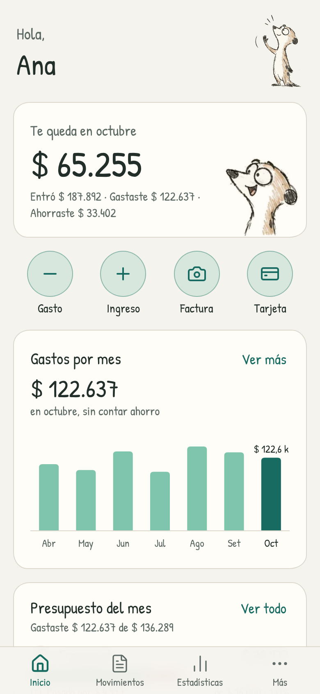
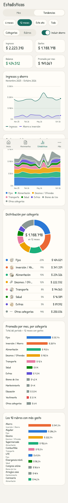
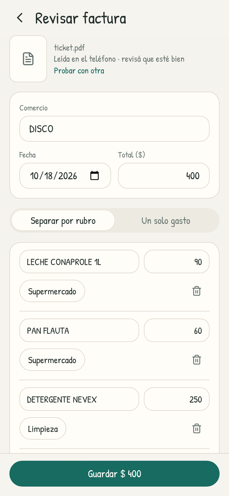

<p align="center"></p>

# Pengar

**Tu dinero, más simple.** Con un suricata que te acompaña. App de iPhone para anotar gastos en dos toques, escanear facturas y tickets (foto o PDF)
y ver cómo se mueve la plata en el tiempo. Todo queda en el teléfono.

<p align="center">
  
  
  
</p>

## Qué hace

- **Anotar rápido**: monto → rubro → listo. Los rubros que más usás aparecen primero; fecha y nota son opcionales.
- **Facturas y tickets**: sacás una foto (o subís un PDF) y Pengar lee comercio, fecha, total y cada renglón, y le
  pone un rubro a cada uno. Podés separar la factura por rubro (comida y limpieza del súper, por ejemplo) o guardarla
  como un solo gasto. Lo que corregís lo aprende. El archivo queda guardado y se ve dentro de la app
  (desde el gasto o en Más → Facturas guardadas), con «Compartir o guardar» para mandarlo a Archivos o por mail.
  - En el iPhone se lee con Vision de Apple (en el teléfono, gratis, sin conexión). Los PDF con texto se leen
    directo; los escaneados se pasan por el lector de fotos.
  - Opcional: con una clave de la API de Claude (Ajustes) la lectura es mejor, sobre todo en tickets arrugados.
- **Gastos fijos**: el alquiler, la luz, Netflix o el sueldo se marcan como fijos (al anotarlos, con «Se repite
  todos los meses», o en Más → Gastos fijos, con sugeridos según tu historial). Cuando llega su día, Inicio muestra
  «Para anotar este mes» con el monto estimado: se anotan de a uno (ajustando el monto), todos juntos o se saltean.
  Si ese mes ya anotaste el rubro (a mano, con una factura o desde la planilla), no lo pide.
- **Estadísticas** (las mismas gráficas del tablero en R):
  - *Mes*: ingresos, gastos, presupuesto y diferencia; real contra presupuesto por categoría (gastado, lo que
    queda, exceso, sin presupuesto); categorías con presupuesto como % del ingreso (el diezmo); detalle por rubro.
  - *Tendencias*: ingresos y ahorro en el tiempo, gastos por categoría en el tiempo (áreas apiladas), distribución,
    promedio mensual por categoría, los 10 rubros con más gasto. Por categorías o por rubros, con o sin ahorro,
    en 6 meses, 12 meses, el año o todo.
- **A tu gusto**: categorías (nombre, ícono, color, presupuesto fijo o % del ingreso, si cuenta como ahorro) y rubros
  (nombre, categoría, palabras para reconocerlos en facturas; se pueden unir o archivar). Moneda y decimales.
- **Metas** de ahorro, **importar** planillas de Excel/CSV, **exportar** a CSV y **respaldo** completo (con facturas).

## Tus datos

Este repositorio es público, así que **tu planilla real no está acá** (`datos/presupuesto.xlsx` está en
`.gitignore`). La primera vez que abrís la app en el iPhone: **Comenzar → Con mi planilla** y elegís tu
`presupuesto.xlsx` desde Archivos/iCloud Drive. Se importan tus 16 categorías con su letra y su presupuesto
(PROYECTADO), los 45 rubros y los 24 meses (nov 2024 – oct 2026). «Diezmos / Ofrendas» queda presupuestado como
10% del ingreso y «Inversión / Ahorro» como ahorro. Los meses importados aparecen como «totales de la planilla»;
lo que anotes desde ahora va día por día. La hoja «Joan» no se importa.

`datos/ejemplo.xlsx` (montos inventados, `node scripts/make-example.mjs`) tiene el mismo formato: lo usan las
pruebas y las capturas. Si copiás tu planilla en `datos/presupuesto.xlsx`, `npm test` también la verifica.
La misma planilla queda en `public/ejemplo.xlsx`: en la bienvenida, **Mirar con datos de ejemplo** la carga (corrida
para que llegue hasta el mes pasado) junto con unos gastos de este mes y una meta, a nombre de «Ana». Inicio y Más
avisan que son datos inventados y «Empezar con los míos» vuelve a la bienvenida.

Otra persona puede empezar **de cero** con categorías sugeridas, o importar su propia planilla con el mismo formato
(un mes por columna) o con un movimiento por fila (Fecha, Rubro, Categoría, Monto).

## Desarrollo

Requisitos: Node 22+. Para el iPhone, una Mac con Xcode 16+.

```bash
npm install
npm run dev          # http://localhost:5173 (en la web las fotos se leen con Tesseract; en una pantalla ancha, dentro de un marco de teléfono)
npm test             # pruebas de la lógica (importar planillas, cuentas, lectura de facturas)
npm run build
npm run shots        # capturas en docs/capturas (importa datos/ejemplo.xlsx)
npm run icons        # íconos a partir del suricata principal
```

### Vista previa web

```bash
npm run build:preview   # dist-preview/pengar.html + files.json
```

Una build para mirar la app en el navegador sin instalar nada, pensada para publicarse como página (artefacto):
abre directo en Inicio con los datos de ejemplo. `scripts/build-artifact.mjs` arma `dist-preview/pengar.html` (sin
`<html>`/`<head>`/`<body>`, porque quien la publica la envuelve en su propio esqueleto) y `dist-preview/files.json`, la
lista de archivos que van al lado con su tipo (JS, CSS, fuentes, imágenes, `ejemplo.xlsx`, el worker de pdf.js), todos
con rutas relativas. En una pantalla ancha la app se ve dentro de un marco de teléfono y, desde 960 px, con una
columna al lado que cuenta qué probar.

Qué no funciona en la vista previa (sí en el iPhone):
- **Fotos de tickets**: «Sacar una foto» y «Elegir de las fotos» quedan deshabilitados. Los **PDF con texto** se leen
  igual, con pdf.js en el navegador; los PDF escaneados no.
- **Lectura con Claude**: Ajustes explica que no está disponible (la página no se puede conectar con Anthropic).
- **Descargas**: exportar a CSV, el respaldo y «Compartir o guardar» una factura avisan que en la vista previa no se
  pueden descargar archivos.
- Los datos quedan solo en ese navegador (IndexedDB; si no se puede usar, en memoria mientras la página esté abierta).

### Instalar en el iPhone

```bash
npm run ios          # build + cap sync + abre Xcode
```

En Xcode: target **App → Signing & Capabilities**, elegí tu equipo (con un Apple ID gratis alcanza para tu propio
teléfono) y, si querés, cambiá el Bundle Identifier (`uy.pengar.app`, también en `capacitor.config.ts`). Conectá el
iPhone y dale ▶︎. Después de cambiar código web: `npm run ios:sync`.

### Estructura

| Carpeta | Qué hay |
|---|---|
| `src/domain` | Lógica pura, con pruebas: modelo, importar planillas, estadísticas, lectura de facturas, rubros sugeridos |
| `src/lib` | Teléfono: guardado (IndexedDB), lector de fotos (Vision / Tesseract), PDF (pdf.js), Claude, archivos |
| `src/screens`, `src/components` | Pantallas y piezas de la interfaz (gráficas en SVG propio, con d3-shape) |
| `ios/App/App/PengarOCRPlugin.swift` | Plugin nativo: texto de una foto con Vision |

El **suricata** (docs/marca) aparece en la bienvenida, el ícono, el inicio (su cara cambia según cómo viene el
mes), los estados vacíos, la lectura de facturas, las metas y el presupuesto, y cada categoría tiene su ilustración
(el suricata en el súper, arreglando el auto, con la mascota…; se elige al editar la categoría). Algunos miran para
el otro lado, para que no vayan todos iguales. `python3 scripts/suricata.py` recorta
las poses de la hoja y les saca el fondo de papel (quedan en `src/assets/suricata`); `<Suricata pose="…" />` las
muestra. La app es solo en modo claro.

Stack: React 18 + TypeScript + Vite + Tailwind, Capacitor 8 para iOS. Tipografía Patrick Hand y paleta del boceto
(verde #176B60, verde suave #7FC4AC, crema #F5F3EE, gris #8A9894). Los colores de las categorías en las gráficas
son una paleta validada para daltonismo; pasadas las 8 más grandes, se juntan en «Otras».

## Pendiente / ideas

- No probé la compilación en Xcode (no hay Mac en este entorno): el plugin Swift sigue el mismo patrón que el de Kvar.
- Sincronizar entre dispositivos (iCloud o Supabase); hoy los datos viven en un solo teléfono, con respaldo manual.
- Ticket oficial de la DGI por el QR (como en Kvar).
